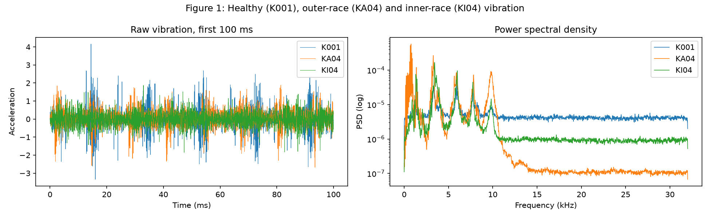
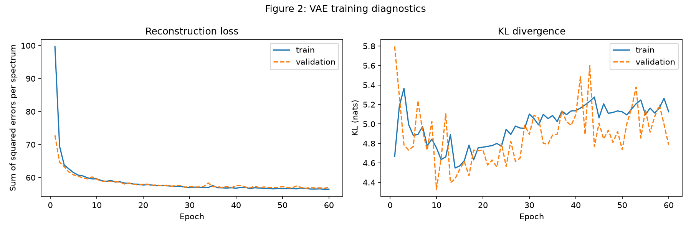
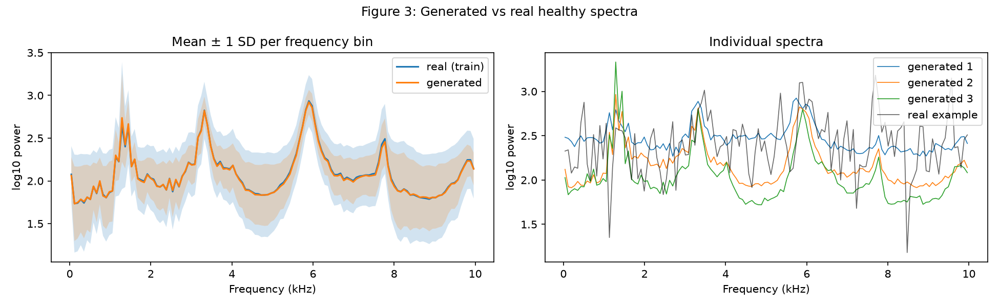
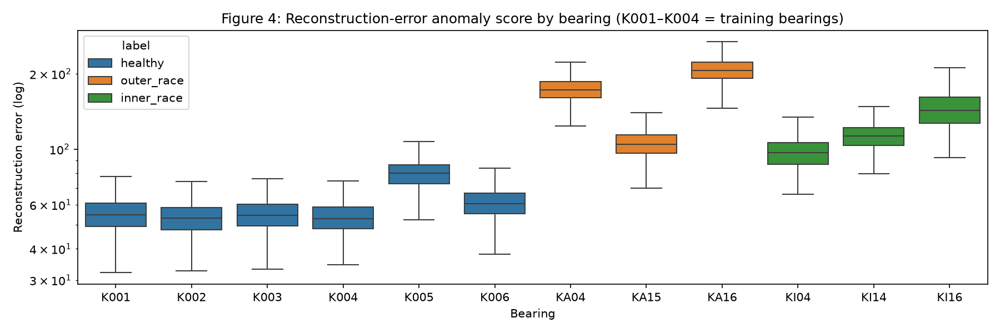
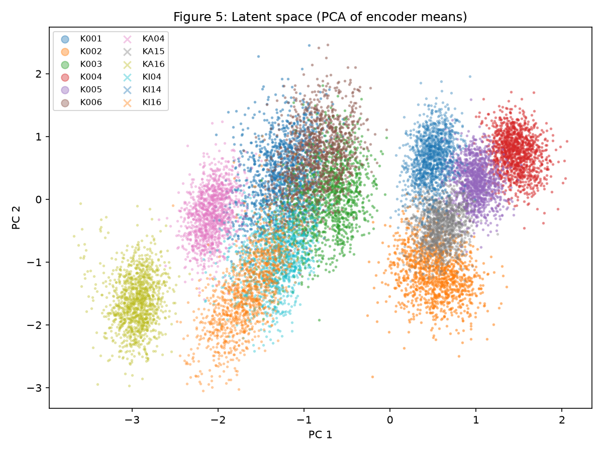

# VAE for Bearing Vibration: Module Summary

**Author:** Min Khaung Min Lwin

## Overview

In this project I trained a variational autoencoder (VAE) on vibration data from rolling bearings. The VAE only sees healthy bearings during training. After training, I use it for two things. First, to generate new healthy vibration spectra. Second, to find damaged bearings, because a model that only knows healthy data should reconstruct damaged data badly.

The data comes from the Paderborn University bearing dataset (Lessmeier et al., 2016). I train on four healthy bearings (K001–K004). Then I test on two healthy bearings the model never saw (K005, K006) and on six bearings with real damage: three with outer-race damage (KA04, KA15, KA16) and three with inner-race damage (KI04, KI14, KI16).

The main results are:

- The generated spectra have the right average shape, but they are too smooth. Their spread is about two-thirds of the real spread.
- The reconstruction error separates every damaged bearing from the unseen healthy bearings, with AUROC between 0.92 and 1.00.
- The biggest failure is the healthy bearing K005. An alarm threshold set on healthy validation data flags 67.5% of its windows as damaged.
- Before training I predicted which damaged bearings would be hardest to detect. The prediction was partly right, and I explain below what it got wrong.

All code, figures and outputs are in `generative_model.ipynb`.

## Dataset or Prompt Description

**Source.** The original dataset was recorded by Lessmeier et al. (2016) at the Chair of Design and Drive Technology (KAt), Paderborn University. I used the copy on Zenodo, uploaded by Jurgen van den Hoogen (Osnabrück University) in July 2025 under a CC BY 4.0 licence (van den Hoogen, 2025). This licence belongs to the Zenodo copy; the original Paderborn page states no licence. The Zenodo record has one `.rar` archive per bearing, 31 archives and about 5.2 GB in total. I only downloaded the 12 bearings I need, which is about 2 GB.

**Recordings.** Each bearing has 20 recordings of 4 seconds at the operating condition N15_M07_F10. This means 1500 rpm, 0.7 Nm load torque and 1000 N radial force. I only use this one condition. Each `.mat` file has several channels (motor currents, speed, torque, force, temperature and vibration). I only use the `vibration_1` channel, which is sampled at 64 kHz. In total this is 240 recordings.

**Bearings and split.** Table 1 shows which bearings I use and for what.

**Table 1**

*Bearings Used and Their Role in the Split*

| Bearing | Condition | Use |
|---|---|---|
| K001–K004 | Healthy | Training (recordings 1–16) and validation (recordings 17–20) |
| K005, K006 | Healthy | Test, unseen healthy |
| KA04, KA15, KA16 | Outer-race damage | Test, damaged |
| KI04, KI14, KI16 | Inner-race damage | Test, damaged |

The damage in the six damaged bearings is real damage from accelerated lifetime tests, not damage made by hand. I split by bearing, so no test bearing is seen in training. This is important, because each bearing has its own "fingerprint", and a split by window would leak that fingerprint into the test set.

**What I found when looking at the data.** Before building the model, I looked at the raw signals and their spectra (Figure 1). Two things surprised me.

1. The healthy bearing K001 is spikier than the damaged ones. Its kurtosis is about 10.7, but KI04 is 2.2 and KA04 is 2.6. So spikiness is not a damage signal in this data.
2. Above about 10–11 kHz the spectrum is a flat noise floor, and its level depends on the bearing. Among the healthy bearings alone, the 15–30 kHz floor changes by about 16 times (K001 −5.40 against K004 −6.60 in log10 power). Inside one bearing it hardly changes (standard deviation 0.01–0.02). Most damaged bearings have a low floor, while K001 and K003 have a high one.

Because of point 2, I decided to **keep only 0–10 kHz**. If I kept the high band, the model could "detect damage" just by learning the floor level, which is a recording effect and not a fault. The resonance peaks (near 1, 3.3, 6, 7.8 and 10 kHz) are all below 10 kHz. The cost is that I lose any fault information above 10 kHz.

**Figure 1**

*Raw Vibration and Power Spectral Density of a Healthy (K001), Outer-Race (KA04) and Inner-Race (KI04) Bearing*

*Note.* Left: the first 100 ms of one recording per bearing. Right: Welch power spectral density of the same recordings, log scale. The flat floor above about 11 kHz differs strongly between bearings.

**Pre-processing.** I cut each recording into 64 ms windows (4096 samples), without overlap. For each window I apply a Hann window, take the FFT power, keep 0–10 kHz, and average 5 bins together. This gives 128 frequency bins of 78 Hz each, on a log10 scale. In total there are 14,903 spectra: 3,970 for training, 998 for validation and 9,935 for testing. Then I standardise each frequency bin with the mean and standard deviation of the training set only.

## Model Design and Training Approach

**Why a VAE.** A VAE (Kingma & Welling, 2014) learns a small latent space and a decoder that maps latent points back to data. It fits this task for two reasons. It is a generative model, so I can sample new spectra from it. And its reconstruction error gives a natural anomaly score: if the VAE only learned healthy spectra, a damaged spectrum should be harder to reconstruct.

**Architecture.** The model is a 1D-convolutional VAE with about 49k parameters (48,961).

- **Encoder:** three 1D convolution layers (16, 32 and 64 channels, kernel 5, stride 2) with LeakyReLU. They reduce the 128 bins to 16 positions. Then two linear layers give the mean and log-variance of an 8-dimensional latent.
- **Decoder:** a linear layer back to 64 × 16, then three transposed 1D convolutions (64 → 32 → 16 → 1 channels) that rebuild the 128-bin spectrum.
- **Sampling:** the reparameterisation trick, `z = mu + sigma * noise`.

I used 1D convolutions because neighbouring frequency bins are related, and the same peak shape can appear at different frequencies. I kept the latent small (8 dimensions) because the healthy data is simple and I have only four training bearings.

**Loss and training.** The loss is the negative ELBO: the sum of squared errors over the 128 bins (a Gaussian decoder), plus the KL divergence to a standard normal prior, with β = 1. I trained for 60 epochs with Adam (learning rate 0.001, batch size 128) and fixed random seeds.

**Training behaviour.** Training was stable (Figure 2). The reconstruction loss fell from about 100 to about 60 in the first 10 epochs, then ended at 56.5 (train) and 57.0 (validation). The two curves stay on top of each other, so there is no overfitting. The KL term was noisy and stayed small, around 5 nats. When I checked it per dimension, one latent dimension carried 2.15 nats and the other seven only 0.24–0.8. So the latent space did not collapse, but the model uses it lightly. One weak point is that my validation set is later recordings of the same four bearings, so it cannot show how the model handles a new bearing.

**Figure 2**

*VAE Training Diagnostics*

*Note.* Left: reconstruction loss (sum of squared errors per standardised spectrum). Right: KL divergence in nats. Solid lines are training, dashed lines are validation (recordings 17–20 of the training bearings).

**Anomaly score.** For each window I encode it, decode from the latent mean, and use the sum of squared errors as the score. I then compute AUROC for each damaged bearing against the unseen healthy bearings K005 and K006.

## Output Evaluation and Interpretation

**Generated samples (Figure 3).** I generated 500 spectra by sampling the latent from the prior and decoding.

- *Strength:* the average generated spectrum matches the average real spectrum almost exactly, including the resonance peaks.
- *Failure, over-smoothing:* the generated spectra are too smooth. The average per-bin standard deviation is 0.279 for generated spectra and 0.421 for real ones. Single real windows jump up and down from bin to bin, but generated ones are smooth curves. My explanation is this: the loss is a squared error, so for each latent point the decoder learns to output the average of the spectra that map there. Also, when I generate samples I only plot the decoder output and do not add any noise back, so the bin-to-bin detail is averaged away.
- *Memorisation check:* I compared each generated sample with 998 training windows and 998 held-out validation windows from the same bearings. If the model had memorised its training data, samples would be closer to the training windows. They are not. The median nearest distance is 6.82 to training and 6.74 to validation, and only 35.0% of samples are closer to training. So I found no sign of memorisation.

**Figure 3**

*Generated Versus Real Healthy Spectra*

*Note.* Left: mean ± 1 standard deviation per frequency bin for 500 generated spectra and the real training spectra. Right: three generated spectra and one real training window.

Evaluating generative models is not simple, and different metrics can tell different stories (Theis et al., 2016). This is why I did not rely on one number. I compared mean and spread per frequency bin, looked at single samples, and checked memorisation separately.

**Anomaly detection (Figure 4 and Table 2).** Every damaged bearing has a higher median score than both unseen healthy bearings.

**Figure 4**

*Reconstruction-Error Anomaly Score by Bearing*

*Note.* Box plots of the per-window reconstruction error, log scale, without outliers. K001–K004 are the training bearings, so their boxes also include windows the model was trained on.

**Table 2**

*Detection Quality (AUROC) of Each Damaged Bearing Against the Unseen Healthy Bearings K005 and K006*

| Bearing | AUROC vs K005/K006 |
|---|---|
| KI04 | 0.916 |
| KA15 | 0.965 |
| KI14 | 0.987 |
| KI16 | 0.999 |
| KA04 | 1.000 |
| KA16 | 1.000 |

The main failure is **K005**. It is healthy, but its median score is 80, against 53–55 for the training bearings and 61 for K006. When I set the alarm threshold at the 99th percentile of the validation scores, it flags 67.5% of K005's windows as damaged (84.8% at the 95th percentile). For K006 this is 7.2% (17.9%). At the same time it still catches 96.4–100% of the windows of every damaged bearing. K005 is the quietest and least spiky healthy bearing, and only K004 in the training set looks like it. So the model partly measures "different from my four training bearings", not only "damaged".

**Prediction before training.** Before any training code existed, I wrote down a prediction in the notebook (git commit `9370025`): if the VAE mainly learns loudness, KI14 and KA15 will be the hardest damaged bearings to detect, because their 0–10 kHz power was inside the healthy range.

- *What it got right:* KA15 and KI14 came out second and third hardest.
- *What it missed:* the hardest bearing was KI04 (AUROC 0.916), which I expected to be easy.
- *Its own test:* I wrote that if KI14 and KA15 were still separated well, the model is using the shape of the spectrum, not just its level. With AUROC 0.987 and 0.965 they are separated well. So the VAE is not only a loudness detector, even though score and loudness are correlated (0.66 on the test windows).

After seeing the results, I found that a different loudness measure (the mean of the log spectrum, which is closer to what the VAE sees) puts KI04, KA15 and KI14 all inside the healthy range. Those are exactly the three lowest AUROCs. But I chose this measure after seeing the results, so it is a hypothesis to test on new bearings, not a confirmation.

**Latent space (Figure 5).** I projected the latent means onto two principal components. PC 1 is basically loudness. The correlation between each bearing's mean PC 1 and its mean loudness is −0.99. Each bearing forms its own cluster, and there is no single "damaged" region. KI14 and KA15 sit next to the quiet healthy bearings K002, K004 and K005. So detection depends on the reconstruction error and not on where a window lands in the latent space.

**Figure 5**

*Latent Space (PCA of Encoder Means), Coloured by Bearing*

*Note.* Each point is one 64 ms window. Healthy bearings are circles and damaged bearings are crosses. The PCA is fitted on the training windows only.

## Ethical Considerations and Responsible Use

**Synthetic data must stay labelled as synthetic.** My generated spectra look right on average, but they are too smooth and they miss the fine detail of real windows. If someone mixes them into a dataset as if they were real, or uses them to test a fault detector, they can give a wrong picture of how well the detector works. Jordon et al. (2022) point out that synthetic data is only useful for a stated purpose, and its limits need to be documented with it. For this project, the generated spectra are only good as "average healthy" examples, and I say this in the notebook.

**False alarms and missed faults both have a cost.** In a real monitoring system, a false alarm means stopping a machine and replacing a bearing that is fine. Many false alarms also make operators stop trusting the alarms. A missed fault is worse, because a damaged bearing can fail and cause damage or injury. My K005 result shows that this model would raise many false alarms on a healthy bearing that is a bit different from the training bearings. So it should not make decisions on its own. It could support a technician, who still checks the machine.

**Honest reporting.** It is easy to change a claim after seeing the results and present it as if it was planned. I wrote my prediction before training, kept it unchanged, and I report clearly which part was right, which part was wrong, and which explanation came afterwards. I think this matters for any monitoring system, because people will trust the reported accuracy.

**Data use.** The dataset has no personal data. The CC BY 4.0 licence comes from the Zenodo re-upload (van den Hoogen, 2025); the original Paderborn page states no licence. I follow the Zenodo licence and credit both the original authors and the Zenodo upload, and I do not commit the raw data to the repository.

## Limitations and Future Improvements

### Limitations

- **Small number of bearings.** I train on only four healthy bearings and test on two healthy and six damaged ones. The K005 result shows that four bearings do not cover the normal variation between healthy bearings.
- **One test rig and one operating condition.** All data is from the Paderborn test rig at N15_M07_F10. I do not know how the model behaves at other speeds, loads, or on other machines.
- **Frequency range.** I removed everything above 10 kHz to avoid learning the noise floor. This also removes any real fault information in that band.
- **Over-smoothed samples.** The generated spectra are not realistic single windows, only realistic averages.
- **Weak use of the latent space.** The KL is small and mostly in one dimension, so the latent space does not capture much variety.
- **Validation set.** My validation data comes from the same bearings as training, so it cannot catch problems with new bearings.
- **Post-hoc explanation.** The loudness explanation for KI04 was found after seeing the results and is not tested yet.
- **One training run and no simple baseline.** I trained with one random seed and did not compare against a simple method, for example a threshold on loudness alone.
- **Window-level evaluation.** AUROC and false-alarm rates are counted per 64 ms window. A real system would decide per bearing or per time period, which can change the numbers.

### Future Improvements

1. **Test the loudness hypothesis on new bearings.** First I will fix the measure (the mean of the log spectrum, `band_power`) and write down which bearings it says will be hard. Then I will check it on damaged bearings the model has never seen, such as KA22, KA30, KI17, KI18 and KI21. This turns the post-hoc explanation into a real test.
2. **Train on more healthy bearings, and validate on a held-out healthy bearing.** Using one whole healthy bearing for validation, instead of later recordings of the training bearings, would show problems like K005 before the test set. More healthy bearings in training should also cover more of the normal variation and reduce false alarms.
3. **Add a loudness-threshold baseline and run several seeds.** A simple threshold on loudness alone shows how much the VAE really adds. Several seeds show how much the AUROC and false-alarm numbers change from run to run.
4. **Make decisions per bearing, not per 64 ms window.** For example, I can average the score over a recording or a time period before comparing it to the threshold. This is closer to how a real monitoring system works, and it should give fewer random false alarms.
5. **Reduce over-smoothing.** I can let the decoder learn the variance of each frequency bin, and add that noise back when sampling, or try a lower β so the model puts more detail into the latent space. Then I will check again if the spread of generated spectra gets closer to the real spread (0.421).

## References

Jordon, J., Szpruch, L., Houssiau, F., Bottarelli, M., Cherubin, G., Maple, C., Cohen, S. N., & Weller, A. (2022). *Synthetic data – what, why and how?* arXiv. https://doi.org/10.48550/arXiv.2205.03257

Kingma, D. P., & Welling, M. (2014). Auto-encoding variational Bayes. In *Proceedings of the 2nd International Conference on Learning Representations (ICLR 2014)*. https://doi.org/10.48550/arXiv.1312.6114

Lessmeier, C., Kimotho, J. K., Zimmer, D., & Sextro, W. (2016). Condition monitoring of bearing damage in electromechanical drive systems by using motor current signals of electric motors: A benchmark data set for data-driven classification. *PHM Society European Conference, 3*(1). https://doi.org/10.36001/phme.2016.v3i1.1577

Theis, L., van den Oord, A., & Bethge, M. (2016). A note on the evaluation of generative models. In *Proceedings of the 4th International Conference on Learning Representations (ICLR 2016)*. https://doi.org/10.48550/arXiv.1511.01844

van den Hoogen, J. (2025). *Paderborn bearing dataset* (Version v1) [Data set]. Zenodo. https://doi.org/10.5281/zenodo.15845309
